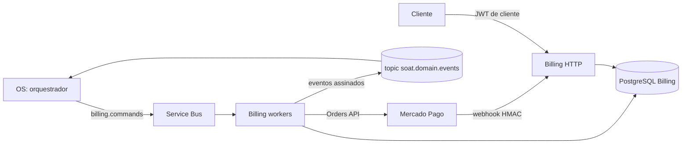

# soat-billing-service

**Billing Service** da Fase 4 do Sistema Integrado de Oficina. É a autoridade
de orçamento versionado, aprovação do cliente, cobrança Mercado Pago,
pagamento, reembolso e notificações. Participa da Saga orquestrada pelo
[OS Service](https://github.com/JoaoGW/soat-api).

## Stack

- Node.js 24, TypeScript e NestJS;
- PostgreSQL exclusivo do serviço com Prisma;
- Azure Service Bus (comandos, eventos, inbox e outbox) com assinatura Ed25519;
- Mercado Pago Orders API (QR), webhook HMAC e consulta canônica;
- OpenTelemetry/New Relic, Jest, SonarJS, Docker, Kustomize e kind.

## Arquitetura



O schema próprio contém orçamento, itens, decisão, cobrança, tentativas,
pagamento, reembolso, inbox, outbox, notificações e auditoria de recuperação.
Nenhum outro serviço lê essas tabelas: o OS conhece o resultado financeiro
apenas pelos eventos. Valores são inteiros em centavos e o orçamento é
versionado; a decisão do cliente é vinculada ao cliente e à versão.

## Saga orquestrada

O OS coordena uma **Saga orquestrada**. A orquestração concentra prazos,
decisões e a ordem das compensações em um único dono do ciclo de vida da OS,
facilitando auditoria e retomada sem compartilhar o banco financeiro; na
coreografia, a regra de pagamento antes do reparo e a ordem dos estornos
ficariam espalhadas pelos participantes. Billing recebe comandos e responde com
eventos:

| Comando recebido | Eventos emitidos |
| --- | --- |
| `billing.generate-quote.v1` | `quote-issued`, `quote-failed` |
| decisão HTTP do cliente | `quote-approved`, `quote-rejected` |
| `billing.create-charge.v1` | `charge-created`, `charge-failed`, `payment-confirmed` |
| `billing.cancel-charge.v1` | `charge-canceled`, `charge-cancel-blocked` |
| `billing.refund-payment.v1` | `payment-refunded`, `refund-blocked` |

Na compensação, Billing exige evidência autenticada de que o reparo não começou
(`execution.work-cancelled.v1`) antes de reembolsar. A cobrança sem pagamento é
cancelada com intenção durável, uma única tentativa e consulta canônica.
Transações locais são atômicas; resultados financeiros incertos (timeout,
resposta perdida, dados divergentes) ficam em reconciliação e nunca repetem a
mutação no provedor. Os schemas estão em
[`docs/contracts/messages`](docs/contracts/messages).

## API REST

A referência está em [`docs/openapi.yaml`](docs/openapi.yaml).

| Rota | Proteção |
| --- | --- |
| `GET /health` | pública |
| `GET /orcamentos/:id` | JWT de cliente, dono do orçamento |
| `POST /orcamentos/:id/aprovar` e `/recusar` | JWT de cliente, `Idempotency-Key` e corpo `{ "versao": 1 }` |
| `GET /cobrancas/:id` e `GET /cobrancas/por-os/:osId` | JWT de cliente, dono do orçamento |
| `POST /webhooks/mercado-pago` | assinatura HMAC do Mercado Pago |

O QR é retornado apenas enquanto a cobrança está criada e não expirou. As
respostas não expõem chaves de idempotência nem identificadores internos do
provedor.

## Mercado Pago

O adapter da Orders API cria a order QR, consulta, cancela e solicita reembolso
com chave de idempotência e sem retry automático; falhas incertas em escrita são
classificadas para reconciliação. A intenção de cobrança é gravada antes do
envio, o envio reivindica a intenção e não repete operações em voo. O webhook
valida HMAC e registra a notificação antes de confirmar o recebimento; o
processador consulta order e pagamento canônicos, confere referência, valor,
moeda, estado e reembolsos, e grava pagamento e evento atomicamente. Pagamento
tardio é persistido para reconciliação sem liberar trabalho.

Para usar credenciais de **teste** do Mercado Pago, configure no secret do
ambiente:

| Variável | Uso |
| --- | --- |
| `MERCADO_PAGO_ACCESS_TOKEN` | Access token da aplicação de teste |
| `MERCADO_PAGO_WEBHOOK_SECRET` | Assinatura secreta do webhook |
| `ENABLE_MERCADO_PAGO_COMMANDS` | Criação de cobrança pelo worker |
| `ENABLE_MERCADO_PAGO_WEBHOOK` e `ENABLE_MERCADO_PAGO_WEBHOOK_PROCESSOR` | Recebimento e processamento do webhook |
| `ENABLE_MERCADO_PAGO_CHARGE_RECONCILIATION` | Recuperação de cobrança incerta por notificação autenticada |
| `ENABLE_MERCADO_PAGO_REFUND_COMMANDS` e `ENABLE_MERCADO_PAGO_REFUND_RECONCILIATION` | Reembolso e sua reconciliação a cada 60 segundos |
| `ENABLE_MERCADO_PAGO_CANCEL_COMMANDS` | Cancelamento de cobrança sem pagamento |

O OS precisa de `MERCADO_PAGO_EXTERNAL_POS_ID` da loja/caixa de teste e o
webhook deve apontar para a URL HTTPS pública do Billing. Todas as travas ficam
desativadas por padrão; habilite-as somente com contas de teste, sem valores
reais. Referências: [Orders QR](https://www.mercadopago.com.br/developers/pt/reference/in-person-payments/qr-code/orders/create-order/post),
[cancelamento](https://www.mercadopago.com.br/developers/pt/reference/in-person-payments/qr-code/orders/cancel-order/post),
[reembolso](https://www.mercadopago.com.br/developers/pt/reference/in-person-payments/qr-code/orders/refund-order/post)
e [webhooks QR](https://www.mercadopago.com.br/developers/pt/docs/qr-code/notifications).

## Configuração

Copie `.env.example`. O worker Service Bus exige `ENABLE_SERVICE_BUS_WORKER=true`,
`SERVICE_BUS_NAMESPACE`, `SERVICE_BUS_COMMAND_QUEUE`, `SERVICE_BUS_EVENT_TOPIC`,
identidade de workload, `OS_MESSAGE_PUBLIC_KEY` e a chave privada exclusiva
`BILLING_MESSAGE_PRIVATE_KEY`; comandos sem assinatura válida seguem à DLQ. A
subscription de evidência (`ENABLE_BILLING_COMPENSATION_EVIDENCE=true`,
`SERVICE_BUS_BILLING_EVIDENCE_SUBSCRIPTION` e `EXECUTION_MESSAGE_PUBLIC_KEY`)
filtra `execution.work-cancelled.v1`; registrar a evidência não dispara
reembolso. O worker SMTP (`ENABLE_NOTIFICATION_WORKER=true`) exige TLS e usa ID
de mensagem estável. Os segredos devem vir do Key Vault; não compartilhe chaves
privadas entre serviços.

## Execução e testes

Com Node 24:

```bash
npm ci
npm run db:generate
npm run lint
npm run quality:sonarjs
npm run build
npm run test:cov
npm run test:coverage-infrastructure
npm run test:contracts
```

`npm run test:integration` exige `DATABASE_URL` para um banco local descartável
cujo nome termine em `_test`, com `npm run db:migrate:deploy` aplicado; a suíte
não ignora ausência de ambiente. Os testes `test:broker-*` usam o emulador
Service Bus descrito no OS. O fluxo completo com os três serviços é o BDD
distribuído do [OS](https://github.com/JoaoGW/soat-api#testes-cobertura-e-qualidade).

### Evidência de cobertura

Medição do [CI](https://github.com/JoaoGW/soat-billing-service/actions/workflows/ci.yml) no commit `4d6cd5e`, com gate mínimo de 80% em cada métrica:

| Escopo | Statements | Branches | Functions | Lines |
| --- | --- | --- | --- | --- |
| Serviço | 87.70% | 82.34% | 88.41% | 92.89% |
| Infraestrutura | 93.33% | 90.81% | 89.34% | 96.64% |

Cada execução publica os totais do próprio SHA no resumo do job e como anotação (`scripts/quality/coverage-summary.cjs`) e anexa o relatório completo como artefato.

`npm run quality:sonarjs` aplica regras selecionadas do analisador SonarJS
(SonarSource) para lógica e segurança com `--max-warnings=0`; é o gate de
qualidade similar ao SonarQube adotado no CI, sem o painel do SonarQube.

## CI/CD e deploy

O [CI](https://github.com/JoaoGW/soat-billing-service/actions/workflows/ci.yml)
roda em todo pull request e em push para `main` e `development`:

1. **quality**: lint, SonarJS, build, observabilidade local, cobertura do
   serviço e da infraestrutura (80% por métrica), contratos e manifests;
2. **integration**: migrations e testes de integração no PostgreSQL, gate de
   cobertura do cancelamento de cobrança e verificação das imagens de runtime e
   migração;
3. **Deploy Kubernetes (kind)**: cria um cluster kind efêmero, carrega as
   imagens do SHA, sobe o PostgreSQL próprio, executa o job de migration e
   aplica o overlay [`deploy/kustomize/overlays/kind`](deploy/kustomize/overlays/kind);
   valida rollout, imagem, `/health`, rota sem token (401) e consulta
   autenticada ao banco (404 para orçamento inexistente);
4. **publish** e **deploy_hml**: em push para `development`, publicam no GHCR e
   aplicam no AKS o mesmo SHA, somente com `HML_DEPLOY_ENABLED=true`.

A `main` exige pull request e os checks. O deploy AKS usa OIDC
(`AZURE_CLIENT_ID`, `AZURE_TENANT_ID`, `AZURE_SUBSCRIPTION_ID`), nomes do AKS,
`BILLING_WORKLOAD_CLIENT_ID` e os secrets `soat-ghcr-pull`,
`soat-billing-runtime` e `soat-billing-migration`, com a ServiceAccount
`soat-billing-migrator`; runtime e migrations usam credenciais distintas e a
migration do mesmo SHA roda antes do rollout. Enquanto a assinatura Azure
estiver desativada, o ambiente kind é o deploy automatizado verificável.

## Observabilidade

Traces e métricas OpenTelemetry são exportados ao New Relic, como na Fase 3:
`OBSERVABILITY_ENABLED=true`, `NEW_RELIC_LICENSE_KEY` no secret,
`OTEL_SERVICE_VERSION` com o SHA e `OTEL_EXPORTER_OTLP_ENDPOINT` opcional. A
instrumentação inicia antes do Nest, propaga o contexto W3C nas mensagens e é
encerrada no shutdown. `npm run build && npm run test:observability-local`
verifica a exportação para um coletor local.

## Operação

O [procedimento de reconciliação](docs/reconciliacao-operacional.md) descreve
ações seguras para resultados incertos e as recuperações auditadas
(`ops:recover-outbox` e `ops:recover-*-dlq`), que só confirmam a mensagem após
comprovar o estado persistido e ficam travadas sem habilitação explícita.

## Dependências

O `package-lock.json` fixa Multer 2.5.0 por `overrides` para corrigir o aviso
GHSA-q7qp-rjg7-q26m na versão transitiva fixada pelo Nest; um teste exercita o
interceptor HTTP com filtro assíncrono. Remova o override quando uma versão
compatível do Nest incorporar a correção. A imagem de runtime remove o CLI
`prisma` e a cadeia `@prisma/config`/`deepmerge-ts`; a imagem separada de
migração conserva o CLI.

Os overrides de `@prisma/config > deepmerge-ts` (8.0.2) e
`gcp-metadata > gaxios` (8.3.2) corrigem os alertas altos da cadeia do CLI de
migração e moderados do detector de metadados; com eles, `npm audit --omit=dev`
não aponta vulnerabilidades. As versões ultrapassam as faixas declaradas pelos
consumidores: `npm run test:metadata-compat` verifica em loopback a detecção,
a resposta e o erro 404 do detector, e o CI valida migrations e a imagem de
migração. Remova os overrides quando as dependências oficiais incorporarem as
correções.
