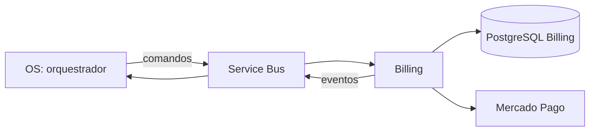

# Billing Service — Fase 4

O CI prepara publicação e deploy em HML somente para `push` em `development`
após qualidade e integração do mesmo SHA. A variável de repositório
`HML_DEPLOY_ENABLED` deve ser `true`; ausente ou diferente de `true`, nenhuma
imagem é publicada e nenhum deploy ocorre. O ambiente `hml` deve fornecer OIDC
(`AZURE_CLIENT_ID`, `AZURE_TENANT_ID`, `AZURE_SUBSCRIPTION_ID`), nomes do AKS e
`BILLING_WORKLOAD_CLIENT_ID`. O namespace precisa ter `soat-ghcr-pull`,
`soat-billing-runtime` e `soat-billing-migration`, além da ServiceAccount
`soat-billing-migrator`; runtime e migrations usam credenciais distintas.
Esses secrets devem ser provisionados de forma segura pelo ambiente, por exemplo
sincronizados do Key Vault. A imagem de migration do mesmo SHA roda antes do
rollout. Este fluxo ainda precisa de ensaio no cluster autorizado.

Billing é responsável por orçamento, aprovação, cobrança, pagamento e
reembolso. Seu PostgreSQL é exclusivo do serviço; nenhum outro serviço deve
ler suas tabelas. A comunicação assíncrona usa comandos e eventos assinados,
inbox e outbox. O OS coordena uma **Saga orquestrada**: após aprovação e
reserva confirmada, solicita a cobrança; em compensação, Billing exige prova
autenticada de que o reparo não começou antes de reembolsar. Transações locais
são atômicas, enquanto resultados financeiros incertos ficam em reconciliação.
A orquestração no OS concentra prazos, decisões e a ordem das compensações,
facilitando auditoria e retomada sem compartilhar o banco financeiro.

`GET /cobrancas/:id` e `GET /cobrancas/por-os/:osId` exigem JWT de cliente;
ambas filtram pelo proprietário do orçamento no banco. O QR é retornado apenas
enquanto a cobrança está criada e não expirou. A resposta não expõe chaves de
idempotência nem identificadores internos do provedor. A referência REST está
em [docs/openapi.yaml](docs/openapi.yaml).

Serviço financeiro em evolução. Os fluxos implementados ainda precisam de
validação com a infraestrutura e a conta de testes reais antes do cutover.

O schema próprio contém orçamento, decisão, cobrança, tentativas, pagamento,
reembolso, inbox e outbox. A migration inicial foi verificada em PostgreSQL
temporário. As funções de domínio testam valores inteiros e decisões por cliente
e versão. A operação interna de decisão grava CAS, decisão, idempotência e
outbox na mesma transação SQL. A geração interna grava orçamento, itens, inbox,
operação, evento e tarefa de notificação em uma transação. A geração é chamada
pelo consumidor opcional. `GET /orcamentos/:id` e os POSTs de aprovação e
recusa exigem JWT de cliente. Os POSTs também exigem `Idempotency-Key` e corpo
`{ "versao": 1 }`; o cliente é obtido do token e validado no orçamento.
O despachante da outbox reserva mensagens entre workers, retenta com o mesmo ID
e registra falhas após cinco tentativas. O adapter Service Bus e o worker usam
identidade de workload e permanecem desativados por padrão. O caminho local foi
testado com o emulador Service Bus. Falhas definitivas de prazo e orçamento existente
geram evento transacional antes do ACK; outros cenários de falha ainda precisam
ser definidos. Faltam o spike com Service Bus real e reprocessamento operacional
das falhas antes de habilitar o worker.
O worker SMTP também é desativado por padrão e exige TLS; ele usa ID de
mensagem estável, mas uma falha após aceitação pelo servidor pode provocar
reenvio. Não há garantia de deduplicação na caixa de entrada. Notificações de
orçamentos já decididos ou expirados são ignoradas.

Com Node 24: `npm ci`, `npm run lint`, `npm run build`, `npm run test:cov`.
O [CI de Billing](https://github.com/JoaoGW/soat-billing-service/actions/workflows/ci.yml)
verifica 80% por métrica no serviço e, separadamente, na infraestrutura com
`npm run test:coverage-infrastructure`; os relatórios são publicados como
artefatos identificados pelo SHA da execução. O acesso ao repositório privado
é necessário para visualizar as evidências.
O CI executa `npm run quality:sonarjs` com regras selecionadas de lógica e
segurança da SonarSource. Esse gate local não substitui todos os recursos do
SonarQube nem seu painel.

Traces e métricas OpenTelemetry são opcionais: defina `OBSERVABILITY_ENABLED=true`
e `NEW_RELIC_LICENSE_KEY` no secret do ambiente; `OTEL_SERVICE_VERSION` deve
receber o SHA e `OTEL_EXPORTER_OTLP_ENDPOINT` pode apontar ao coletor HTTPS.
A aplicação inicializa a instrumentação antes do Nest e encerra o SDK no
shutdown. `npm run build && npm run test:observability-local` verifica a
exportação para coletor local sem credenciais externas. A validação do trace
distribuído no New Relic continua dependente do ambiente e da configuração.
Para gerar o cliente e aplicar migrations ao banco dedicado configurado em
`DATABASE_URL`, usar `npm run db:generate` e `npm run db:migrate:deploy`.
Não executar migrations sobre o banco legado.
`npm run test:integration` exige `DATABASE_URL` para um banco local cujo nome
termine em `_test`, com migrations aplicadas; não ignora ausência de ambiente.
Use um banco descartável dedicado à suíte: comandos pendentes de outras
execuções podem ser selecionados pelo worker e interferir nas verificações.

A intenção de cobrança é gravada com chave idempotente antes do envio. O envio
reivindica a intenção, não repete operações em voo e sinaliza reconciliação em
caso de resposta incerta. O consumidor opcional grava inbox e emite evento de
cobrança criada na mesma transação da confirmação local. Prazo vencido produz
evento de falha antes do ACK. Outros resultados incertos permanecem para retry
e reconciliação; esgotadas as tentativas, seguem para a DLQ. O procedimento
operacional e os reconciliadores disponíveis não cobrem todas as falhas.

O consumidor de cobrança exige `ENABLE_SERVICE_BUS_WORKER=true`,
`ENABLE_MERCADO_PAGO_COMMANDS=true` e `MERCADO_PAGO_ACCESS_TOKEN`; ambos os
workers e o comando financeiro permanecem desativados por padrão. Não habilitar
até validar os fluxos e credenciais em ambiente de teste.

O adapter de Orders API prepara criação de QR, consulta, cancelamento e
solicitação de reembolso com chave de idempotência e sem retry automático.
Falhas incertas em operações de escrita são classificadas para reconciliação.
O webhook usa HMAC e registra notificações antes de confirmar o recebimento.
Um processador opcional consulta a order e o pagamento canônicos, confere
referência, valor, moeda, estado, reembolsos e data de aprovação, e grava o
pagamento e seu evento atomicamente. Pagamento tardio é persistido para
reconciliação, sem emitir evento que libere trabalho. Os testes usaram
PostgreSQL local e HTTP simulado; a integração real ainda precisa ser validada.
O endpoint e processador exigem `ENABLE_MERCADO_PAGO_WEBHOOK=true`,
`ENABLE_MERCADO_PAGO_WEBHOOK_PROCESSOR=true`, `MERCADO_PAGO_WEBHOOK_SECRET` e
`MERCADO_PAGO_ACCESS_TOKEN`. Estão desativados por padrão e não devem ser
habilitados antes da validação completa em ambiente de teste.

Referências: [Orders QR](https://www.mercadopago.com.br/developers/pt/reference/in-person-payments/qr-code/orders/create-order/post),
[cancelamento](https://www.mercadopago.com.br/developers/pt/reference/in-person-payments/qr-code/orders/cancel-order/post),
[reembolso](https://www.mercadopago.com.br/developers/pt/reference/in-person-payments/qr-code/orders/refund-order/post)
e [webhooks QR](https://www.mercadopago.com.br/developers/pt/docs/qr-code/notifications).

O fluxo de reembolso registra intenção e chave idempotente antes da chamada,
exige evidência persistida de cancelamento anterior ao início do reparo e
confirma o resultado por consulta canônica antes de gravar o evento na outbox.
Resultados incertos permanecem em reconciliação, sem nova chamada automática.
Com `ENABLE_MERCADO_PAGO_REFUND_RECONCILIATION=true`, junto das configurações do
worker e do reembolso, o Billing consulta a ordem canônica a cada 60 segundos
para recuperar um reembolso comprovadamente integral, único e correspondente à
transação original. Um envio ainda em voo aguarda pelo menos dois minutos. A
recuperação nunca repete o pedido ao provedor; dados divergentes ou inconclusivos
permanecem em reconciliação. A integração real continua exigindo validação com
credenciais e contas de teste do Mercado Pago.
O comando de reembolso é gravado antes do ACK e aguardará evidência autenticada
na subscription separada. Os testes usam
PostgreSQL local e provedor simulado; não habilitar reembolso automático antes
de validar identidade dos produtores e o contrato real do Mercado Pago.

O comando financeiro é desativado por padrão e exige
`ENABLE_MERCADO_PAGO_REFUND_COMMANDS=true`, a subscription de evidência,
`MERCADO_PAGO_ACCESS_TOKEN` e o worker Service Bus. Uma chamada financeira
incerta permanece em reconciliação; não há repetição automática do pedido.
`ENABLE_MERCADO_PAGO_CHARGE_RECONCILIATION=true` habilita recuperação de
cobranças incertas a partir de notificações autenticadas pendentes. O worker
consulta a order pelo ID da notificação e confere referência, valor, moeda,
orçamento e intenção persistida antes de gravar `charge-created`; ele nunca
cria uma segunda order. Um envio em voo aguarda dois minutos. A recuperação
exige uma notificação com o ID da order; sem ela, ou se a consulta for
divergente, a cobrança permanece em reconciliação para análise operacional.
Valide o comportamento com contas de teste do Mercado Pago antes de habilitar.
Os testes distribuídos usam broker emulado e provedor simulado; o fluxo ainda
precisa ser validado com o broker e o provedor reais.

O [procedimento de reconciliação](docs/reconciliacao-operacional.md) descreve
ações seguras para resultados incertos. Permanecem pendentes validação real do
SMTP, Service Bus, Orders API, webhook e deploy, além de casos não cobertos por
reconciliação automática e análise mais ampla que as regras SonarJS locais.

O transporte exige assinatura Ed25519 para autenticar o OS. Quando o worker é
habilitado, configure `OS_MESSAGE_PUBLIC_KEY` e a chave privada exclusiva de
Billing em `BILLING_MESSAGE_PRIVATE_KEY`; eventos são assinados e comandos sem
assinatura válida seguem à DLQ antes do processamento. Não compartilhe chaves
privadas entre serviços. A distribuição e a rotação das chaves ainda precisam
ser configuradas e testadas no ambiente real.

A subscription de evidência é opcional e desativada por padrão. Requer
`ENABLE_BILLING_COMPENSATION_EVIDENCE=true`,
`SERVICE_BUS_BILLING_EVIDENCE_SUBSCRIPTION`,
`EXECUTION_MESSAGE_PUBLIC_KEY` e worker Service Bus habilitado. A subscription
deve filtrar `execution.work-cancelled.v1`; registrar a evidência não dispara
reembolso. A subscription e as permissões precisam ser validadas no broker.

## Dependência temporariamente sobrescrita

O `package-lock.json` fixa Multer 2.5.0 por `overrides` para corrigir o aviso
GHSA-q7qp-rjg7-q26m na versão transitiva fixada pelo Nest. O teste de
compatibilidade exercita o interceptor HTTP do Nest com filtro assíncrono; ele
não reproduz todas as condições do aviso. Remova o override quando uma versão
compatível do Nest incorporar a correção e valide novamente build, testes e
auditoria. A atualização para Nest 12 também exige adaptar o Jest a módulos ESM.

A imagem de runtime remove dependências de desenvolvimento e opcionais após
gerar o cliente Prisma. Isso mantém o cliente e exclui o CLI opcional `prisma`
e sua cadeia `@prisma/config`/`deepmerge-ts` do runtime. A imagem separada de
migração conserva o CLI e ainda precisa de tratamento dos alertas dessa cadeia.
O CI constrói as duas imagens, testa o cliente com PostgreSQL e verifica o
healthcheck e as migrations; integrações com Azure e Mercado Pago reais exigem
validação no ambiente configurado.
